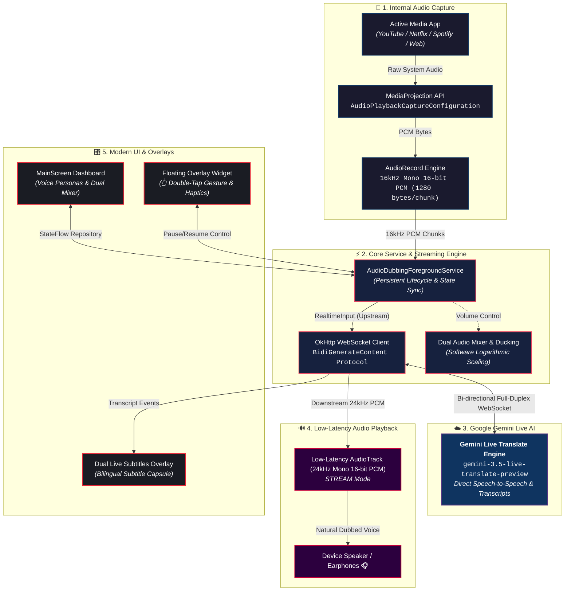

<div align="center">
  

  <h1>🎙️ iva - Live Translate & Audio Dubbing</h1>

  <p><strong>Real-time AI vocal dubbing & dual live subtitles for any Android app, powered by Google's Gemini 3.5 Live Translate.</strong></p>

  <p>
    <a href="https://github.com/navidseyedain/ALAD-Mobile"></a>
    <a href="https://developer.android.com/"></a>
    <a href="https://kotlinlang.org/"></a>
    <a href="https://aistudio.google.com/"></a>
    <a href="LICENSE"></a>
  </p>

  <p>
    <b>Watch any foreign video or listen to any podcast. Hear and read it in your native language - instantly.</b><br/>
    No subscriptions. No third-party accounts. 100% free and open-source.
  </p>
</div>

---

> 📌 **Project Origin & Attribution:**
> This project is **customized and developed from the open-source project [ALAD-Mobile](https://github.com/navidseyedain/ALAD-Mobile)** created by **Navid Seyedain**. The user interface, control system, voice persona workflows, audio sliders, and translation pipelines have been refactored and tailored for real-time Vietnamese speech dubbing.

---

## 🌍 Overview

**iva (iva - Live Translate)** is a native Android application that provides real-time AI speech dubbing and live bilingual subtitles for any media playback on your device.

Working in the background, **iva** captures clean digital system audio directly from any active app (YouTube, Netflix, Spotify, TikTok, podcasts, university lectures, etc.) using Android's native `MediaProjection API`, streams it to Google's **Gemini 3.5 Live Translate** engine over a full-duplex bi-directional WebSocket, and plays back fluid, natural translated speech with sub-second latency while displaying floating live subtitles.

---

## ✨ Key Features & Enhancements

### 🇻🇳 1. Vietnamese-Focused Real-Time Translation
- Optimized for spoken Vietnamese with natural Northern phrasing (Hà Nội dialect prompt instruction).
- Direct Speech-to-Speech translation using the `gemini-3.5-live-translate-preview` model over Google Generative Language Live WebSocket.

### 🎙️ 2. Top 6 Curated AI Voice Personas (Main Screen Access)
Voice personas have been placed directly on the main dashboard for instant switching without navigating into Settings:
- **Female Voices:**
  - `Aoede`: Melodic, warm, and expressive
  - `Kore`: Gentle, serene, and calm
  - `Zephyr`: Crisp, clear, and modern
- **Male Voices:**
  - `Puck`: Energetic, friendly, and lively
  - `Charon`: Deep, resonant, and authoritative
  - `Fenrir`: Crisp, direct, and professional
- **Instant Reconnect:** Changing voices seamlessly re-establishes the active session with the selected voice configuration.

### 🎚️ 3. Dual Audio Mixer & Canvas Volume Sliders
- **SleekVolumeSlider:** Custom Canvas-rendered slider component that provides smooth touch feedback and eliminates thumb alignment issues found in standard Material 3 sliders.
- **Independent Controls:**
  - AI Dubbed Voice volume (0-100%) with instant **Mute** toggle.
  - Original Video/Media volume (0-100%) with instant **Mute** toggle.
- **Smart Audio Ducking:** Automatically attenuates original background audio while the AI voice is speaking.

### 💬 4. Floating Overlay Controller & Dual Live Subtitles
- **Compact Overlay Widget:** A floating pill widget allows full control outside the app.
- **Double-Tap Quick Control:** Double-tap anywhere on the floating widget to immediately pause or resume dubbing.
- **Dual Live Subtitles Capsule:** Translucent floating window showing original spoken words alongside live translated subtitles.
- **3 Dubbing Modes:**
  - `Voice + Subtitles (Hybrid)`: Spoken AI voice with simultaneous on-screen subtitles.
  - `Audio Only`: Dubbed audio only (optimized for background listening and screen-off usage).
  - `Subtitles Only`: Silent translation mode displaying only the live subtitle overlay.

### 🎨 5. Modern Dark Red UI
- Obsidian dark theme with distinct red accent branding (`#E72234`).
- Studio audio bars spectrum visualizer animating smoothly according to real-time audio amplitude.

---

## 🧠 System Architecture & Workflow



### Core Audio Invariants:
- **Audio Capture:** 16,000 Hz, 16-bit Mono PCM, 1280 bytes per chunk (~40ms).
- **Audio Playback:** 24,000 Hz, 16-bit Mono PCM via `AudioTrack` STREAM mode.
- **AI Model:** `gemini-3.5-live-translate-preview` via Google Live Bidi WebSocket endpoint.
- **Minimum OS:** Android 10.0 (API level 29) required for internal audio playback capture.

---

## 🚀 Getting Started

### Prerequisites
1. **Android Device:** Android 10.0 (API 29) or newer.
2. **Gemini API Key:** A free API key from [Google AI Studio](https://aistudio.google.com/app/apikey).

### Configuration & Usage
1. Open **iva**, tap the ⚙️ **Settings** icon in the top corner.
2. Enter your **Gemini API Key** and tap **Save Settings**.
3. On the Main Screen:
   - Select your preferred narrator in **AI Voice Persona**.
   - Balance the AI dubbed voice and original video audio with the **Dual Audio Mixer**.
   - Enable the **Floating Widget** switch if you want multitasking overlay controls.
4. Tap **Start Translate** and grant the screen capture/audio permission prompt.

---

## 🛠️ Build from Source

### Requirements:
- JDK 17 or higher
- Android SDK (API 34, Android Build Tools)

### Build Commands:
```bash
# Clone repository
git clone https://github.com/navidseyedain/ALAD-Mobile.git
cd ALAD-Mobile

# Or clone from your custom repository fork:
# git clone <your-repo-url>

# Build Debug APK
./gradlew assembleDebug

# Install directly to a connected Android device via ADB
./gradlew installDebug
```

The compiled APK will be located at:
`app/build/outputs/apk/debug/app-debug.apk`

---

## 📚 Technical Documentation (Developer Wiki)

For in-depth architectural and implementation details, refer to the [`wiki/`](wiki/README.md) directory:
- [**System Architecture**](wiki/architecture.md) - Comprehensive layer breakdown and component lifecycle.
- [**Audio Pipeline**](wiki/audio-pipeline.md) - Capture mechanics, AudioTrack playback, and DSP mixing.
- [**Gemini Live WebSocket Protocol**](wiki/gemini-live-websocket.md) - BidiGenerateContent frames, payloads, and reconnect strategies.
- [**Foreground Service & Floating Overlay**](wiki/foreground-and-overlay.md) - Background execution, MediaProjection capture activity, and WindowManager overlay compose views.
- [**State & Data Management**](wiki/data-and-state.md) - DubbingSessionRepository StateFlows and DataStore preferences.

---

## 🔧 Troubleshooting

| Issue | Cause | Solution |
|---|---|---|
| **No translation audio** | Media app is not currently playing sound or Gemini API quota is exhausted. | Ensure media is playing in the background app and verify API quota in Google AI Studio. |
| **WebSocket connection fails** | Invalid API Key or network blocks WebSockets. | Double-check API Key in Settings or check internet connection / VPN. |
| **Dubbing stops when switching apps** | Android battery optimization terminated the background service. | Go to *App Info > Battery > Unrestricted*. |
| **Audio not capturing in apps like Netflix** | Protected by DRM or system phone call policy. | Android OS strictly blocks recording for DRM-protected streams and active phone calls. |

---

## 📜 Credits & License

Distributed under the **MIT License**. See [`LICENSE`](LICENSE) for details.

### Acknowledgments:
- **Upstream Project:** [**ALAD-Mobile**](https://github.com/navidseyedain/ALAD-Mobile) created by [**Navid Seyedain**](https://github.com/navidseyedain).
- **Google DeepMind & Google AI Studio:** For Gemini Live streaming architecture and API access.
