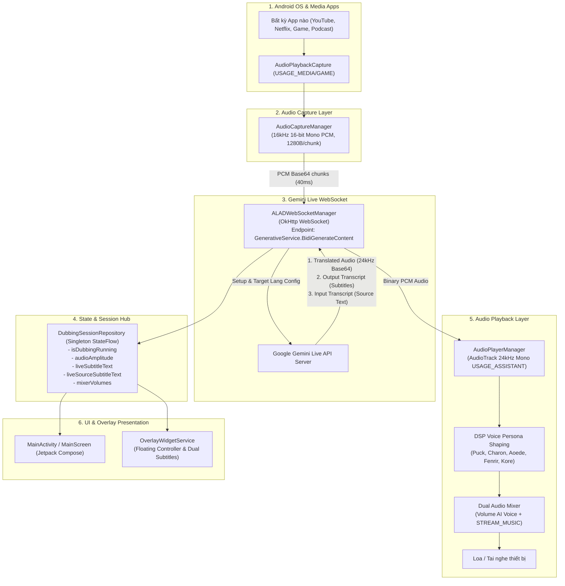

# 🏗️ Kiến trúc Tổng thể (System Architecture)

ALAD Mobile hoạt động như một lớp trung gian kỹ thuật số (audio interceptor & bridge), bắt trực tiếp âm thanh phát ra từ các ứng dụng khác trên Android (YouTube, TikTok, Netflix, Spotify, Podcast Player...), đưa qua luồng xử lý AI đám mây độ trễ thấp của Google Gemini, và phát giọng thuyết minh cùng phụ đề theo thời gian thực.

---

## 🔄 Sơ đồ luồng dữ liệu toàn hệ thống

---

## 🧩 Các Module cốt lõi

### 1. Presentation Layer (`com.alad.app.presentation.*`)
- **`MainActivity.kt`**: Điểm khởi đầu chính của ứng dụng, thiết lập `MainScreen`, xin quyền Notification, và thiết lập Window edge-to-edge.
- **`MainScreen.kt`**: Giao diện Compose phong cách Frosted Glass/Bento UI tối màu:
  - Hiển thị System Status & Audio Visualizer (sóng âm thanh dao động dựa trên RMS amplitude).
  - Chọn ngôn ngữ đích (Target Language) và phương ngữ/ngữ điệu (Dialect).
  - Bảng điều khiển bộ trộn âm thanh Dual Mixer (Âm lượng AI, Âm lượng media gốc, Mute controls).
  - Lựa chọn Voice Persona (Puck, Charon, Aoede, Fenrir, Kore) và Chế độ thuyết minh (Voice + Subtitles / Audio Only / Subtitles Only).
- **`SettingsScreen.kt`**: Quản lý Gemini API Key, hướng dẫn lấy key từ Google AI Studio, chọn Voice mặc định.

### 2. Core Service Layer (`com.alad.app.core.service.*`)
- **`AudioDubbingForegroundService`**: Quản lý vòng đời dịch vụ nền. Khi chạy, service hiển thị thông báo liên tục (ongoing notification), giữ cho quá trình thu phát không bị Android hệ thống đóng lại khi chuyển sang ứng dụng khác.
- **`TransparentCaptureActivity`**: Activity trong suốt, khởi chạy trong tích tắc để kích hoạt popup xin quyền cấp phép `MediaProjection` từ người dùng mà không che màn hình hiện tại.
- **`OverlayWidgetService`**: Tạo cửa sổ nổi lơ lửng trên mọi app thông qua `WindowManager`. Cung cấp nút điều khiển nhanh (Start/Stop, Mute, Toggle Subtitles) và hộp phụ đề song ngữ tự động dạt sang góc màn hình.

### 3. Core Audio Layer (`com.alad.app.core.audio.*`)
- **`AudioCaptureManager`**: Tận dụng API `AudioPlaybackCaptureConfiguration` được giới thiệu từ Android 10 (API 29). Bắt luồng âm thanh kỹ thuật số nội bộ từ các app khác với cấu hình 16kHz Mono. Loại trừ UID của ứng dụng ALAD để tránh tình trạng micro bắt lại chính giọng thuyết minh của app (Echo cancellation).
- **`AudioPlayerManager`**: Quản lý phát âm thanh PCM 24kHz bằng `AudioTrack` ở chế độ Stream Low Latency. Tích hợp bộ lọc DSP IIR định hình chất giọng (Persona) và Soft Limiter để tối đa hóa âm lượng mà không bị rè (clip).
- **`AudioUtils`**: Tính toán RMS (Root Mean Square) từ các byte PCM và chuẩn hóa về dải `0.0f` đến `1.0f` dùng cho visualizer.

### 4. Core Network Layer (`com.alad.app.core.network.*`)
- **`ALADWebSocketManager`**: Kết nối WebSocket 2 chiều với Google Gemini Multimodal Live API (`BidiGenerateContent`). Gửi gói tin khởi tạo `setup` với cấu hình giọng nói và dịch thuật, sau đó stream liên tục các chunk âm thanh PCM 16kHz dạng Base64 và phân tích cú pháp JSON trả về.

### 5. Data & Repository Layer (`com.alad.app.data.repository.*`)
- **`DubbingSessionRepository`**: Kho lưu trữ trạng thái phiên làm việc dạng in-memory singleton. Đảm bảo UI trong ứng dụng và Overlay Widget luôn đồng bộ trạng thái dù Service chạy nền.
- **`UserPreferencesRepository`**: Lưu trữ bền vững các cài đặt người dùng vào Jetpack DataStore Preferences (API Key, ngôn ngữ đích, dialect, âm lượng, persona...).
