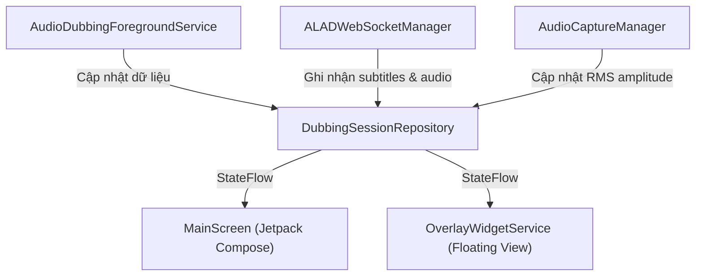

# 💾 Quản lý Trạng thái & Lưu trữ Dữ liệu (State & Data Management)

Tài liệu này chi tiết hóa cách thức ALAD / IVA quản lý trạng thái phiên dịch theo thời gian thực (in-memory) và lưu trữ cấu hình người dùng (persistent DataStore).

---

## 1. Phiên làm việc thời gian thực: `DubbingSessionRepository`

### Vị trí: `app/src/main/kotlin/com/alad/app/data/repository/DubbingSessionRepository.kt`

`DubbingSessionRepository` là một Singleton in-memory đóng vai trò **Single Source of Truth** cho toàn bộ dữ liệu trạng thái tương tác giữa `AudioDubbingForegroundService`, `OverlayWidgetService` và các màn hình Compose (`MainScreen`, `SettingsScreen`).



### Các StateFlow chính:
- `isDubbingRunning: StateFlow<Boolean>`: Trạng thái phiên dịch đang bật hay tắt.
- `audioAmplitude: StateFlow<Float>`: Biên độ âm thanh chuẩn hóa (0.0f - 1.0f) dùng vẽ sóng âm Visualizer.
- `liveSubtitleText: StateFlow<String>`: Văn bản phụ đề đã dịch nhận từ Gemini Live.
- `liveSourceSubtitleText: StateFlow<String>`: Văn bản gốc nhận từ mô hình nhận dạng giọng nói Gemini.
- `dubbingVolume: StateFlow<Float>` & `originalVolumeRatio: StateFlow<Float>`: Giá trị âm lượng tức thời của mixer.

---

## 2. Cấu hình người dùng bền vững: `UserPreferencesRepository`

### Vị trí: `app/src/main/kotlin/com/alad/app/data/repository/UserPreferencesRepository.kt`

Sử dụng Jetpack DataStore Preferences để lưu trữ bất đồng bộ các tùy chọn cấu hình của người dùng.

### Các khóa Preferences quan trọng:
- `GEMINI_API_KEY`: Khóa API Google Gemini Live.
- `TARGET_LANG`: Mã ngôn ngữ đích đã chọn (`"vi"`, `"en"`, `"ja"`). Mặc định: `"vi"`.
- `TARGET_DIALECT`: Mã ngữ điệu hoặc phương ngữ đã chọn (ví dụ `"vi-VN-N"`, `"en-US"`). Mặc định: `"vi-VN-N"`.
- `VOICE_PERSONA`: Chất giọng AI (`Zephyr`, `Achernar`, `Fenrir`, `Leda`). Mặc định: `"Zephyr"`.
- `DUBBING_MODE`: Chế độ thuyết minh (`HYBRID`, `AUDIO_ONLY`, `SUBTITLE_ONLY`).
- `DUBBING_VOLUME` & `ORIGINAL_VOLUME`: Mức âm lượng mặc định của hai kênh.
- `SHOW_DUAL_SUBTITLES`: Tùy chọn hiển thị đồng thời cả phụ đề gốc và phụ đề dịch trên Overlay.

---

## 3. Danh mục ngôn ngữ & Phương ngữ: `Languages.kt`

### Vị trí: `app/src/main/kotlin/com/alad/app/presentation/main/Languages.kt`

Đã được tối ưu hóa chỉ tập trung vào 3 ngôn ngữ mục tiêu chính (không kèm emoji cờ, dùng Select Box chuẩn):

```kotlin
val supportedLanguages = listOf(
    "vi" to "Tiếng Việt",
    "en" to "English",
    "ja" to "日本語"
)

val supportedDialects: Map<String, List<DialectOption>> = mapOf(
    "vi" to listOf(
        DialectOption("vi-VN-N", "Giọng Miền Bắc", "Nói bằng tiếng Việt giọng Bắc (Hà Nội) tự nhiên, rõ ràng, phát âm chuẩn.")
    ),
    "en" to listOf(
        DialectOption("en-US", "American", "Speak in natural General American English pronunciation and vocabulary"),
        DialectOption("en-GB", "British", "Speak in British English (Received Pronunciation)"),
        DialectOption("en-AU", "Australian", "Speak in natural Australian English accent and terminology"),
        DialectOption("en-IN", "Indian", "Speak in clear Indian English accent")
    ),
    "ja" to listOf(
        DialectOption("ja-JP", "Standard Japanese (標準語)", "Speak in natural standard Japanese (Hyojungo/Tokyo dialect) with polite and natural intonation")
    )
)
```
