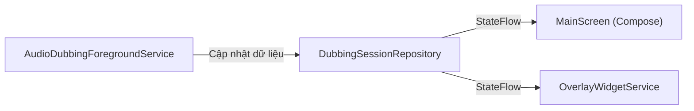

# 💾 Quản lý Trạng thái & Dữ liệu (State & Data Management)

Kiến trúc luồng dữ liệu trong ALAD Mobile tuân thủ mô hình Unidirectional Data Flow (UDF) kết hợp Reactive Programming bằng Kotlin StateFlow và Jetpack DataStore.

---

## 1. Phiên làm việc thời gian thực: `DubbingSessionRepository`

### Vị trí: `app/src/main/kotlin/com/alad/app/data/repository/DubbingSessionRepository.kt`

Đây là Singleton Object in-memory đóng vai trò "Single Source of Truth" (Nguồn chân lý duy nhất) cho toàn bộ tiến trình thuyết minh trực tiếp:



### Các trường StateFlow quan trọng:
- `isDubbingRunning: StateFlow<Boolean>`: Trạng thái phiên dịch đang bật hay tắt.
- `audioAmplitude: StateFlow<Float>`: Biên độ âm lượng đầu vào (0.0f - 1.0f) dùng để tạo hiệu ứng sóng âm động.
- `connectionStatus: StateFlow<String>`: Tình trạng kết nối WebSocket ("Connecting", "Connected", "Gemini Ready", "Disconnected", "Error").
- `liveSubtitleText: StateFlow<String>`: Nội dung phụ đề dịch thời gian thực (được tự động nối chuỗi và dọn dẹp khoảng trắng).
- `liveSourceSubtitleText: StateFlow<String>`: Nội dung transcript lời nói gốc.
- `dubbingVolume: StateFlow<Float>` & `originalVolumeRatio: StateFlow<Float>`: Giá trị âm lượng tức thời của mixer.

---

## 2. Lưu trữ cấu hình bền vững: `UserPreferencesRepository`

### Vị trí: `app/src/main/kotlin/com/alad/app/data/repository/UserPreferencesRepository.kt`

Sử dụng Jetpack DataStore Preferences thay thế hoàn toàn cho SharedPreferences truyền thống, đảm bảo tính bất đồng bộ (Asynchronous) và an toàn luồng (Thread-safety):

```kotlin
val Context.dataStore: DataStore<Preferences> by preferencesDataStore(name = "alad_settings")
```

### Các khóa cài đặt chính:
- `API_KEY`: Chuỗi Gemini API Key.
- `TARGET_LANG`: Mã ngôn ngữ đích được chọn (mặc định: `"vi"`).
- `TARGET_DIALECT`: Mã ngữ điệu hoặc phương ngữ đã chọn (ví dụ `"vi-VN-N"`, `"en-US"`).
- `VOICE_PERSONA`: Nhân vật giọng AI (`Puck`, `Charon`, `Aoede`, `Fenrir`, `Kore`).
- `VOLUME_RATIO`: Tỷ lệ âm lượng giọng đọc AI (0.0f - 1.0f).
- `ORIGINAL_VOLUME`: Tỷ lệ âm lượng âm thanh nền video gốc.
- `DUBBING_MODE`: Chế độ thuyết minh (`HYBRID`, `AUDIO_ONLY`, `SUBTITLE_ONLY`).
- `SHOW_DUAL_SUBTITLES`: Bật/tắt phụ đề song ngữ.

---

## 3. Danh mục ngôn ngữ & Phương ngữ: `Languages.kt`

### Vị trí: `app/src/main/kotlin/com/alad/app/presentation/main/Languages.kt`

Đã được tối ưu hóa chỉ tập trung vào 3 ngôn ngữ mục tiêu chính:

```kotlin
val supportedLanguages = listOf(
    "vi" to "🇻🇳 Tiếng Việt",
    "en" to "🇺🇸 English",
    "ja" to "🇯🇵 日本語"
)

val supportedDialects: Map<String, List<DialectOption>> = mapOf(
    "vi" to listOf(
        DialectOption("vi-VN-N", "🇻🇳 Giọng Miền Bắc (Hà Nội)", "Nói bằng tiếng Việt giọng Bắc (Hà Nội) tự nhiên, rõ ràng, phát âm chuẩn."),
        DialectOption("vi-VN-S", "🇻🇳 Giọng Miền Nam (Sài Gòn)", "Nói bằng tiếng Việt giọng Nam Bộ tự nhiên, thân thiện, truyền cảm.")
    ),
    "en" to listOf(
        DialectOption("en-US", "🇺🇸 American", "Speak in natural General American English pronunciation and vocabulary"),
        DialectOption("en-GB", "🇬🇧 British", "Speak in British English (Received Pronunciation)"),
        DialectOption("en-AU", "🇦🇺 Australian", "Speak in natural Australian English accent and terminology"),
        DialectOption("en-IN", "🇮🇳 Indian", "Speak in clear Indian English accent")
    ),
    "ja" to listOf(
        DialectOption("ja-JP", "🇯🇵 Standard Japanese (標準語)", "Speak in natural standard Japanese (Hyojungo/Tokyo dialect) with polite and natural intonation")
    )
)
```
